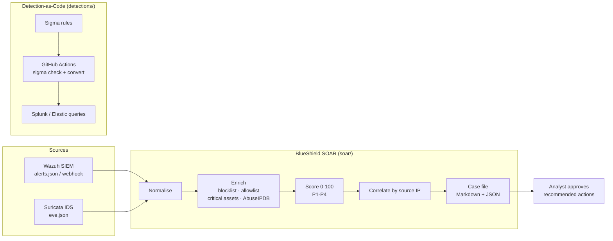

# BlueShield: Detection-as-Code & SOAR Lab


BlueShield is the automation layer of my home SOC. It does two jobs:

1. **Detection-as-Code.** Detection rules live in Git as [Sigma](https://github.com/SigmaHQ/sigma).
   Every push runs CI that validates the rules and converts them to Splunk SPL and Elastic queries,
   so detections are reviewed, versioned and tested like software.
2. **SOAR (Security Orchestration, Automation and Response).** Alerts from
   [Wazuh](https://github.com/Pzycokid/wazuh-soc-lab) and [Suricata](https://github.com/Pzycokid/suricata-ids-lab)
   are normalised, enriched with threat intel, scored, correlated by source IP, and turned into
   prioritised case files with ATT&CK-mapped response steps.

> **Human in the loop:** BlueShield *recommends* containment (block IP, disable account, isolate
> host) but never executes it. An analyst approves every action, which keeps automation from
> blocking the wrong thing.

## Architecture



## Example: brute force followed by a successful login

Input: two Wazuh alerts from [`samples/wazuh_alerts.json`](samples/wazuh_alerts.json), a brute
force (rule 100100) and then a successful login from the same IP (rule 100101).

```
$ python3 -m soar.cli samples/wazuh_alerts.json samples/suricata_eve.json --out cases
7 case(s) written to cases/
  P1  100  BS-AD0B2845  203.0.113.50    Possible compromise: successful SSH login from 203.0.113.50 after brute force
  P1  100  BS-A3297339  10.0.0.66       LAB POLICY Telnet connection to internal host
  P1   80  BS-23DFD5BD  10.0.0.77       LAB CRED Possible SSH brute force
  P3   56  BS-B14BBCFC  -               Suspicious PowerShell script block (download cradle or encoded command)
  P3   56  BS-BFA67AB3  -               Account added to local Administrators group by labadmin
  P3   45  BS-F28CE94E  192.168.56.10   LAB DNS Query to commonly abused TLD
  P4   22  BS-182AE8E4  192.168.56.5    SSH brute force: 192.168.56.5 failed 8+ logins in 2 minutes
```

Ten raw alerts become seven cases (non-alert events such as plain DNS logs are skipped). The brute force and the successful login from
`203.0.113.50` are merged into one P1 case, and the three scan/Telnet alerts from `10.0.0.66` are
merged into another. The authorised scanner on the allowlist (`192.168.56.5`) drops to P4.

Each case explains its score and lists the next steps, for example:

```
## Why this score
- base severity 61 from wazuh
- source on blocklist (+30)
- target is a critical asset (+15)
- 1 other alert(s) from same source (+5)

## Recommended actions (analyst approval required)
- [ ] Reset the account's password and end its active sessions
- [ ] Review what the account did after logging in
- [ ] Block source IP at the firewall
- [ ] Check for a successful login from the same IP
- [ ] Enforce key-based SSH / MFA on the target
```

## Scoring model

| Factor | Effect |
|---|---|
| Base severity | Wazuh level scaled to 0–70; Suricata severity 1/2/3 → 65/45/25 |
| Source IP on `intel/blocklist.txt` | +30 |
| AbuseIPDB confidence ≥ 50 (optional, needs `ABUSEIPDB_API_KEY`) | +20 |
| Target in `intel/critical_assets.txt` | +15 |
| Other alerts from the same source in the batch | +5 each (max +20) |
| Source IP on `intel/allowlist.txt` | −40 |

Priority: **P1** ≥ 80 · **P2** ≥ 60 · **P3** ≥ 35 · **P4** below.

## Usage

BlueShield needs only the Python 3.10+ standard library. `requirements.txt` is just for the tests.

```bash
git clone https://github.com/Pzycokid/blueshield.git && cd blueshield
python3 -m soar.cli samples/wazuh_alerts.json samples/suricata_eve.json --out cases

pip install -r requirements.txt
python3 -m pytest -q                              # 14 tests: engine, CLI and webhook
```

**Real-time mode:** run `python3 -m soar.webhook --port 8088` and POST alerts (a JSON object or a
list) to `http://127.0.0.1:8088/alert`; `GET /health` returns `{"status": "ok"}`. Each request
becomes one or more cases as it arrives. The receiver has no authentication, so it binds to
localhost by default. Use `--host 0.0.0.0` only on an isolated lab network, so a Wazuh
integration on another VM can reach it.

**Detections:** add a rule to `detections/sigma/` and push. The CI workflow runs `sigma check`,
converts every rule to Splunk SPL and Elastic (Lucene), and publishes them as the
`converted-detections` build artifact. Current rules:

| Rule | Detects | ATT&CK |
|---|---|---|
| [`lnx_ssh_failed_password`](detections/sigma/lnx_ssh_failed_password.yml) | Failed SSH password logins (brute force building block) | T1110.001 |
| [`win_new_user_added_to_admins`](detections/sigma/win_new_user_added_to_admins.yml) | Member added to local Administrators (Event 4732, S-1-5-32-544) | T1098 |
| [`win_susp_powershell_download_cradle`](detections/sigma/win_susp_powershell_download_cradle.yml) | Download-and-execute PowerShell script blocks (Event 4104) | T1059.001, T1105 |

## Repository layout

```
blueshield/
├── detections/sigma/        # Sigma rules (detection-as-code)
├── soar/engine.py           # normalise, enrich, score, correlate, cases
├── soar/cli.py              # batch mode
├── soar/webhook.py          # real-time receiver for Wazuh
├── intel/                   # blocklist, allowlist, critical assets
├── samples/                 # sample Wazuh and Suricata alerts
├── tests/                   # pytest (engine, CLI, webhook)
└── .github/workflows/ci.yml # SOAR tests on 3.10-3.12 + Sigma validation and conversion
```

## Roadmap

- [x] Sigma detection-as-code with CI validation and Splunk / Elastic conversion
- [x] SOAR engine: normalise, enrich, score, correlate, case files
- [x] Real-time webhook for Wazuh
- [ ] Pull new-host findings from [attack-surface-monitor](https://github.com/Pzycokid/attack-surface-monitor)
- [ ] Optional approved-action mode (e.g. push an approved IP block to a firewall API)
- [ ] Case metrics: time to triage, alerts per source, false-positive rate

## Author

**Likhith H S**, M.Sc. Cyber Security, NFSU Goa · CEH v12 & CCNA trained ·
[LinkedIn](https://www.linkedin.com/in/likhith15) · [GitHub](https://github.com/Pzycokid)

## License

[MIT](LICENSE)
